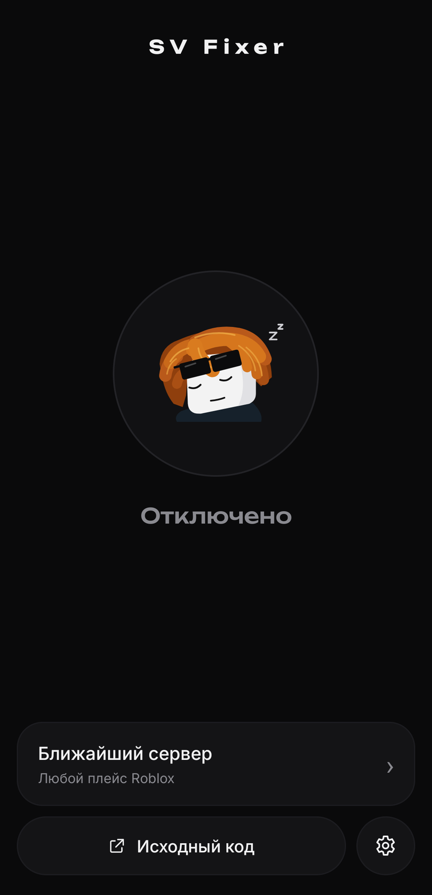

# SV Fixer

SV Fixer — локальный VPN для Android 10 и новее. Он обрабатывает трафик Roblox, YouTube, поддерживаемых браузеров и игр Supercell. Для Telegram в приложении есть отдельный MTProto-прокси.

<table>
  <tr>
    <td align="center"><br>Главный экран</td>
    <td align="center"><br>Настройки</td>
  </tr>
</table>

## Сборка

Понадобятся JDK 17 и Android SDK Platform 34. Укажите путь к SDK в `ANDROID_HOME` или в локальном файле `local.properties`. Gradle Wrapper скачает Gradle и зависимости при первой сборке.

На Linux и macOS:

```sh
./gradlew testDebugUnitTest assembleDebug
```

В Windows:

```powershell
.\gradlew.bat testDebugUnitTest assembleDebug
```

Готовый APK для проверки появится в `app/build/outputs/apk/debug/`. Установите его на устройство с архитектурой `arm64-v8a` или `armeabi-v7a`. Библиотеки для обеих архитектур лежат в `app/src/main/jniLibs/`. Чтобы пересобрать их из `native/third_party/`, установите Android NDK 27.2 и запустите `.\native\build.ps1` в Windows.

## Подключение

1. Откройте SV Fixer, нажмите центральную кнопку и разрешите создание VPN в системном окне Android.
2. Для Telegram откройте **Настройки → Домен Cloudflare**, сохраните адрес совместимого ретранслятора и вернитесь в настройки. Нажмите **Прокси**, выберите Telegram и подтвердите подключение. Приложение создаёт ключ локального прокси при первом использовании и хранит его в закрытых настройках Android.
3. Если соединение не устанавливается, откройте **Настройки → Проверка соединения**. На экране **Отчёт об ошибке** можно посмотреть и сохранить результаты.

С пустым полем домена VPN работает самостоятельно. Прокси Telegram и ретрансляция ресурсов Clash Royale требуют настроенного сервера. Для Clash Royale сервер должен поддерживать маршруты ресурсов игры. Сборка из этого репозитория запускается без сервера автообновлений. В своей сборке его можно указать через свойство Gradle `fixerUpdateHost`.

## Куда идёт трафик

SV Fixer применяет правила DNS и проксирования к выбранным Android-приложениям. Roblox отправляет игровой UDP напрямую, а часть DNS-запросов идёт через DNS over HTTPS. Для адресов некоторых российских сайтов используется системный DNS, а для игровых хостов Supercell предусмотрены отдельные резолверы. Telegram подключается к прокси на телефоне, откуда трафик идёт к указанному ретранслятору.

Проект распространяется по [лицензии MIT](LICENSE). Лицензии нативных библиотек, шрифтов и других зависимостей приведены в [уведомлениях о сторонних компонентах](THIRD_PARTY_NOTICES.md).
