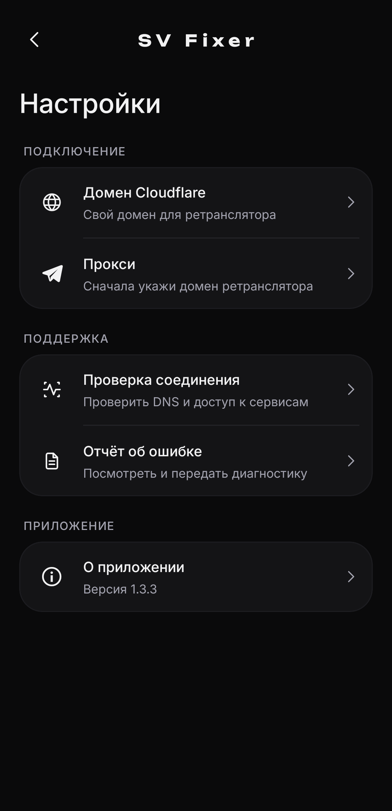

<a name="sv-fixer"></a>

# 🛠️ SV Fixer

SV Fixer — Android-приложение для случаев, когда в Roblox не загружаются изображения, YouTube не воспроизводит видео или игры Supercell не подключаются. Приложение создаёт локальный VPN, обрабатывает DNS-запросы и соединения поддерживаемых приложений на телефоне. Для Telegram есть отдельный MTProto-прокси, которому нужен совместимый ретранслятор.

**[Быстрый старт](#quick-start)** · **[Вопросы и проблемы](#faq)** · [Roblox](#roblox-guide) · [Telegram и Clash Royale](#relay)

[Как работает VPN](#vpn) · [Диагностика](#diagnostics) · [Сборка](#build) · [Карта исходников](#source-map)

<a name="quick-start"></a>
<a name="быстрый-старт"></a>

## 🚀 Быстрый старт

Понадобится телефон или планшет с **Android 10 (API 29) или новее** и процессором ARM (`arm64-v8a` или `armeabi-v7a`). Для запуска VPN установите хотя бы одно поддерживаемое приложение. Root не нужен. Android разрешает один активный VPN в профиле, поэтому перед запуском выключите другой VPN, включая блокировщики рекламы в режиме VPN. [Список поддерживаемых приложений](#vpn)

1. Скачайте исходники через **Code → Download ZIP** или клонируйте репозиторий. [Соберите APK](#build-apk) и перенесите `app-debug.apk` на телефон.
2. Откройте APK. Если Android попросит разрешение на установку, выдайте его тому приложению, из которого открыли файл, например файловому менеджеру.
3. Откройте **SV Fixer**, нажмите круглую кнопку в центре и подтвердите системный запрос на подключение VPN. Когда на главном экране появится **Подключено**, откройте нужную игру, YouTube или браузер.
4. Чтобы управлять VPN из шторки, откройте редактирование быстрых настроек Android и добавьте плитку **SV Fixer**. На Android 13 и новее разрешите уведомления, если хотите видеть статус, кнопку **Выключить** и результаты замера пинга Roblox.

Поле **Домен Cloudflare** при первом запуске пустое. Для Roblox, YouTube и игровых подключений Supercell его заполнять не требуется.

<table>
  <tr>
    <td align="center"><br>Главный экран</td>
    <td align="center"><br>Настройки</td>
  </tr>
</table>

<a name="vpn"></a>
<a name="как-работает-vpn"></a>

## 🌐 Как работает VPN

SV Fixer использует системный `VpnService` и направляет в виртуальный интерфейс TUN IPv4-трафик установленных приложений из встроенного списка. В него входят Roblox, YouTube, ReVanced с пакетом `app.revanced.android.youtube`, Clash Royale, Brawl Stars, Chrome, Mi Browser, Яндекс Браузер, Firefox, Opera и Samsung Internet. Остальные приложения используют обычное подключение Android. Выбор приложений вручную и режим Android «Постоянный VPN» отсутствуют.

| Трафик | Что делает SV Fixer |
| --- | --- |
| Roblox | Для доменов Roblox и его CDN применяет отдельные правила DNS. В DNS-запросах Roblox через DoH добавляет ECS с нулевым префиксом, чтобы запрос не указывал подсеть пользователя. Игровой UDP отправляет напрямую с телефона. |
| YouTube и браузеры | Передаёт TCP-соединения через локальный SOCKS5-прокси byedpi, который меняет отправку первых пакетов для обхода DPI. Некоторые QUIC-пакеты отбрасывает, чтобы клиент повторил подключение по TCP. |
| Clash Royale и Brawl Stars | Для игровых хостов проверяет ответы Null’s Proxy (DNS over TLS) и Xbox DNS (обычный UDP). Проверяет доступность полученного IPv4-адреса по TCP на порту 9339. Для ресурсов Clash Royale можно подключить отдельный ретранслятор. |
| Остальной DNS внутри VPN | Использует Google и Cloudflare через DNS over HTTPS (DoH) с резервным DNS по UDP. Для некоторых российских доменов использует системный DNS. |

Поддержка сервисов зависит от сети и провайдера. VPN предназначен для перечисленных приложений и работает с IPv4. DNS выбранных приложений может уходить сторонним резолверам, а при включённом ретрансляторе через его оператора проходит трафик прокси Telegram и запросы ресурсов Clash Royale.

<a name="roblox-guide"></a>
<a name="roblox"></a>

## 🎮 Roblox

Для обычной игры включите VPN и запустите Roblox. Чтобы подобрать публичный сервер из SV Fixer, откройте **Ближайший сервер** на главном экране.

1. Введите название игры и выберите её в списке **Похожие игры**. Для поиска по ссылке Roblox или числовому ID плейса вставьте ссылку или ID и нажмите **Найти**. При пустом поиске показывается список **Недавние**.
2. SV Fixer получает публичный список серверов у Roblox, отбирает серверы со свободными местами и выбирает один из половины с наименьшим пингом по данным API. Для Murder Mystery 2 в выборку попадают серверы, где уже есть хотя бы три игрока.
3. Приложение передаёт выбранный плейс и экземпляр сервера клиенту Roblox. Если VPN включён и удалось измерить время ответа на игровые UDP-пакеты, SV Fixer покажет результат в уведомлении.

«Ближайший» здесь означает подбор по оценке задержки из списка Roblox. Местоположение телефона при подборе не используется, а фактический пинг зависит от сети. Поиск использует публичное API Roblox без доступа к аккаунту.

<a name="relay"></a>
<a name="домен-для-telegram-и-clash-royale"></a>

## 🔗 Домен для Telegram и Clash Royale

Для Telegram нужен совместимый WebSocket-ретранслятор, который принимает подключения к `/apiws` и передаёт трафик в дата-центр Telegram, указанный в параметре `dst`. Для загрузки ресурсов Clash Royale этот же сервер должен обслуживать `/clash-assets` по защищённому WebSocket. Исходники серверной части и готовый домен в этом репозитории отсутствуют.

1. В SV Fixer откройте **Настройки → Домен Cloudflare**. Введите полный адрес Worker, например `worker.account.workers.dev`. Если ретранслятор работает на `tg.example.com`, введите `example.com`. Нажмите **Сохранить**.
2. Включите SV Fixer. Для Telegram откройте **Настройки → Прокси**. В системном окне **Открыть прокси в Telegram** выберите установленный клиент, которым пользуетесь, и подтвердите подключение уже в нём.
3. В Telegram проверьте выбранный прокси в разделе **Настройки → Данные и память → Прокси**. Если клиент переключается на другую запись, отключите **Автопереключение прокси**. В этом же разделе можно отключить или удалить прокси SV Fixer.

Telegram подключается к локальному MTProto-прокси `127.0.0.1:21441`. Пока SV Fixer включён, прокси связывается с ретранслятором по WebSocket. Ключ локального прокси создаётся при первом использовании и хранится в закрытых настройках приложения. Для Clash Royale достаточно сохранить домен и включить SV Fixer. Маршрут применяется к загрузкам с `game-assets.clashroyaleapp.com`, а игровой сервер по-прежнему подключается отдельно.

Кнопка **Очистить домен** в разделе **Настройки → Домен Cloudflare** отключает ретранслятор. Если в Telegram выбран прокси SV Fixer, отключите его в клиенте.

<a name="faq"></a>
<a name="частые-проблемы"></a>

## ☑️ Распространенные вопросы и проблемы

### VPN сразу отключается или Android не показывает запрос. Что делать?

Отключите другой VPN, в том числе блокировщик рекламы в режиме VPN. В системных настройках этого VPN проверьте, что выключены **Постоянный VPN** и **Блокировать подключения без VPN**. Запустите SV Fixer снова.

### VPN отключается после блокировки экрана. Что проверить?

Посмотрите сообщение под круглой кнопкой SV Fixer. Если сбой повторяется, проверьте ограничения в **Настройки Android → Приложения → SV Fixer → Батарея** и сохраните диагностический отчёт. [Как сохранить отчёт](#diagnostics)

### Почему в Roblox серые иконки или аватары?

Включите SV Fixer, полностью закройте Roblox и откройте его снова. Если SV Fixer предупреждает о частном DNS, временно отключите вручную заданный сервер **Частный DNS** в сетевых настройках Android и повторите проверку.

### Что делать, если Roblox показывает ошибку 279 при входе?

Попробуйте другой сервер или другую сеть. Если ошибка повторяется, сохраните отчёт и укажите плейс, провайдера и тип сети. Уточните, запускали ли вы игру из Roblox или через **Ближайший сервер**. [Как сохранить отчёт](#diagnostics)

### Почему YouTube не загружает видео на моей сети?

Запустите **Настройки → Проверка соединения** на проблемной сети и сравните результат с другим подключением, например Wi‑Fi вместо мобильной сети. Доступность IPv4 и эффективность стратегии byedpi зависят от сети и провайдера.

### Когда нужно заполнять «Домен Cloudflare»?

Укажите адрес своего ретранслятора для прокси Telegram или загрузки ресурсов Clash Royale. Для Roblox, YouTube и подключения к игровым серверам Supercell поле можно оставить пустым. [Настройка домена](#relay)

### Почему Telegram остаётся на «Подключение…»?

Убедитесь, что SV Fixer включён, домен указан верно, а в нужном клиенте Telegram выбран локальный прокси SV Fixer. В отчёте проверьте строку `telegram.relay`. Код `http_429` означает, что ретранслятор ограничил запросы. [Как сохранить отчёт](#diagnostics)

### Clash Royale запускается, но ресурсы не скачиваются. Что проверить?

Проверьте, что ретранслятор на указанном домене обслуживает `/clash-assets`, и посмотрите строку `clash.relay` в отчёте. [Настройка домена](#relay)

### Что проверить, если не удаётся войти в Clash Royale или Brawl Stars?

Запустите проверку соединения на проблемной сети. В отчёте найдите счётчики DNS игровых серверов `dns.clash.*` и `dns.brawl.*`. [Как запустить проверку](#diagnostics)

<a name="diagnostics"></a>
<a name="диагностика"></a>

## 🔍 Диагностика

1. Откройте **Настройки → Проверка соединения → Запустить проверку** на той сети, где возник сбой. Тест сравнивает ответы системного DNS и Google DoH и проверяет доступность выбранных IPv4-адресов по TCP через текущее подключение вне VPN.
2. Включите SV Fixer и повторите действие, которое вызывает ошибку. Если под круглой кнопкой появилось сообщение, нажмите его, чтобы открыть диагностику.
3. Откройте **Настройки → Отчёт об ошибке**. С экрана **Проверка соединения** к этому же отчёту ведёт кнопка **Посмотреть отчёт**. Нажмите **Скопировать отчёт**, чтобы получить текст, или **Передать отчёт → Сохранить .txt**, чтобы сохранить файл `sv-fixer-report.txt`. Через **Передать отчёт → Открыть Telegram** можно выбрать чат и отправить файл вручную.

Отчёт включает версию приложения, модель и версию Android, тип сети, состояние VPN и ретрансляторов, а также результаты проверок и счётчики DNS. Перед передачей проверьте содержимое. Для разработчиков журнал приложения доступен через `adb logcat -s Fixer`.

В описании ошибки укажите версию SV Fixer, провайдера, Wi-Fi или мобильную сеть, шаги воспроизведения и что показала проверка. Это поможет сопоставить сбой с DNS, доступностью сервера или запуском VPN.

<a name="из-чего-состоит-проект"></a>

## 🧩 Из чего состоит проект

| Компонент | Роль |
| --- | --- |
| Kotlin 1.9.24, Android SDK и XML-разметка | Экраны, системный `VpnService`, разбор пакетов, правила DNS, локальный мост Telegram, подбор серверов Roblox и диагностика. |
| hev-socks5-tunnel 2.19.3 | JNI-библиотека, которая передаёт трафик из TUN в локальный SOCKS5. Внутри используются lwIP, LibYAML и hev-task-system. |
| byedpi 0.17.3 | Локальный SOCKS5-прокси с обработкой TCP для обхода DPI. В проекте используется версия с патчем, собранная как исполняемый файл `libbyedpi.so`. |
| Gradle 8.10.2, Android Gradle Plugin 8.5.2, JDK 17 | Сборка APK через Gradle Wrapper. В JVM-тестах используются JUnit 4 и `org.json`. |

<a name="build"></a>
<a name="сборка"></a>

## 📦 Сборка

<a name="build-apk"></a>
<a name="apk-и-тесты"></a>

### APK и тесты

Установите JDK 17 и Android SDK с Android SDK Platform 34 и Build-Tools 34. Укажите папку SDK через `ANDROID_HOME` или параметр `sdk.dir` в локальном файле `local.properties`. При первой сборке Gradle Wrapper скачает Gradle и зависимости.

На Linux и macOS запустите Gradle Wrapper из терминала.

```sh
./gradlew testDebugUnitTest assembleDebug
```

Если файл `gradlew` после распаковки ZIP не исполняется, выдайте ему право на запуск командой `chmod +x gradlew`.

В Windows запустите его из PowerShell.

```powershell
.\gradlew.bat testDebugUnitTest assembleDebug
```

Готовый файл — `app/build/outputs/apk/debug/app-debug.apk`. Его можно открыть на устройстве или установить через ADB из Android SDK Platform-Tools. Для установки через ADB включите отладку по USB.

```sh
adb install -r app/build/outputs/apk/debug/app-debug.apk
```

<a name="нативные-библиотеки"></a>

### Нативные библиотеки

Готовые файлы для обеих ARM-архитектур уже включены, поэтому обычная сборка APK обходится без NDK. Для пересборки библиотек из исходников установите Android NDK 27.2. Скрипт предназначен для Windows. Он ищет NDK внутри Android SDK или использует путь из `ANDROID_NDK_HOME`.

```powershell
.\native\build.ps1
```

Скрипт собирает `libbyedpi.so` и `libhev-socks5-tunnel.so` и записывает их в каталоги ABI внутри [app/src/main/jniLibs](app/src/main/jniLibs/).

<a name="выпуск-и-обновление"></a>

### Выпуск и обновление

Задача Gradle `assembleRelease` создаёт `app/build/outputs/apk/release/app-release.apk`. Чтобы подписывать релиз своим ключом, настройте локальный `keystore.properties` или переменные окружения, перечисленные в [конфигурации сборки](app/build.gradle.kts). При отсутствии релизного ключа сборка использует отладочную подпись.

Для установки поверх старой сборки нужны совпадающие идентификатор приложения и ключ подписи, а также `versionCode` не ниже установленного. Если подписи различаются, потребуется удалить предыдущую сборку вместе с её локальными настройками.

Встроенная проверка обновлений выключена по умолчанию. Для собственной сборки передайте Gradle свойство `-PfixerUpdateHost=updates.example.com` и разместите `version.json` и APK под `/update/` на совместимом хосте Cloudflare. Сервер обновлений и ключи подписи в репозиторий не входят.

Модуль обновлений подключается к IPv4-адресу этого домена по TCP на порту 80 и использует HTTP без TLS. Сначала он запрашивает `/__down?bytes=1` с заголовком `Host: speed.cloudflare.com`. После ответа он запрашивает нужный файл под `/update/` по тому же соединению, добавляя точку в конец имени хоста, например `Host: updates.example.com.`. Оба запроса должны вернуть HTTP 200, поэтому хост, доступный только по HTTPS или отвечающий перенаправлением, несовместим с этим клиентом. [Updater.kt](app/src/main/java/com/october/fixer/Updater.kt)

Перед установкой SV Fixer сравнивает SHA-256 скачанного APK со значением из `version.json` и передаёт файл системному установщику. Android запрашивает подтверждение и проверяет подпись APK для обновления установленного приложения.

<a name="source-map"></a>
<a name="карта-исходников"></a>

## 🗂️ Карта исходников

| Файл или каталог | Что искать |
| --- | --- |
| [MainActivity.kt](app/src/main/java/com/october/fixer/MainActivity.kt), [SettingsScreen.kt](app/src/main/java/com/october/fixer/SettingsScreen.kt), [res](app/src/main/res/) | Главный экран, настройки, разметка, строки и графика. |
| [AndroidManifest.xml](app/src/main/AndroidManifest.xml), [FixTileService.kt](app/src/main/java/com/october/fixer/FixTileService.kt) | Разрешения Android, службы приложения и плитка быстрых настроек. |
| [FixVpnService.kt](app/src/main/java/com/october/fixer/FixVpnService.kt), [TProxy.kt](app/src/main/java/com/october/fixer/TProxy.kt), [UdpRelay.kt](app/src/main/java/com/october/fixer/UdpRelay.kt) | Жизненный цикл VPN, список пакетов, запуск нативного туннеля и прямая отправка UDP. |
| [DnsPolicy.kt](app/src/main/java/com/october/fixer/DnsPolicy.kt), [RuDomains.kt](app/src/main/java/com/october/fixer/RuDomains.kt) | Правила DNS и домены, для которых используется системный резолвер. |
| [TgBridge.kt](app/src/main/java/com/october/fixer/TgBridge.kt), [ClashAssetRelay.kt](app/src/main/java/com/october/fixer/ClashAssetRelay.kt) | Локальные прокси и подключения к внешнему ретранслятору. |
| [ServerPicker.kt](app/src/main/java/com/october/fixer/ServerPicker.kt), [RobloxCatalog.kt](app/src/main/java/com/october/fixer/RobloxCatalog.kt), [Mm2.kt](app/src/main/java/com/october/fixer/Mm2.kt) | Поиск плейсов и выбор публичного сервера Roblox. |
| [Diagnostics.kt](app/src/main/java/com/october/fixer/Diagnostics.kt), [ReportFormat.kt](app/src/main/java/com/october/fixer/ReportFormat.kt) | Сетевые проверки, события VPN и формат отчёта. |
| [native/build.ps1](native/build.ps1), [native/third_party](native/third_party/), [jniLibs](app/src/main/jniLibs/) | Сборка, исходники и готовые нативные библиотеки. |
| [app/src/test](app/src/test/) | JVM-тесты DNS, пакетов, Roblox, прокси, обновлений и диагностики. |

<a name="лицензия"></a>

## 📄 Лицензия

Код SV Fixer распространяется по [лицензии MIT](LICENSE). Авторы, версии и лицензии нативных библиотек, шрифтов Inter и Unbounded и других сторонних компонентов перечислены в [THIRD_PARTY_NOTICES.md](THIRD_PARTY_NOTICES.md).
